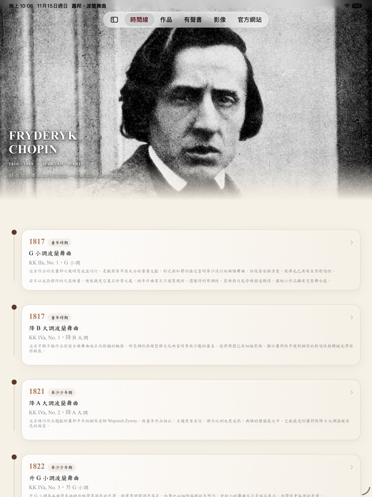

# 多頁面電子書 App｜蕭邦・波蘭舞曲

以 Frédéric Chopin 的波蘭舞曲為主題，使用 SwiftUI 製作的多頁面電子書 App。作品結合歷史時間線、樂曲導讀、有聲內容、影片與官方網站，帶領使用者從文字、聲音及影像認識蕭邦與波蘭舞曲。

## 製作動機

波蘭舞曲不只是音樂作品，也承載了蕭邦對故鄉的思念、對歷史的感慨，以及深刻的民族精神。

蕭邦身處異鄉，眼看祖國陷入動盪，卻無法回到故土守護家園。他將無能為力的悲傷、對故鄉的眷戀，以及不向命運屈服的意志寫進旋律之中。激昂的樂段像是對命運的吶喊，低沉的音符則藏著無法說出口的思念。

因此，這個 App 不只整理作品資料，更希望透過時間線、導讀、有聲書與影像，讓使用者走進蕭邦的內心世界，感受音樂背後交織的悲傷、驕傲與愛國情懷。

## App 畫面

| iPhone 時間線 | iPhone 有聲書 |
|---|---|
|  |  |

| iPad 主畫面 | iPad 有聲書 |
|---|---|
|  |  |

## 主要功能

App 包含五個主要分頁：

- **時間線**：依年代閱讀蕭邦生平、歷史事件與作品。
- **作品**：透過清單或網格瀏覽波蘭舞曲，進入詳細頁閱讀導讀。
- **有聲書**：以水平分頁方式依創作時期閱讀與聆聽。
- **影像**：使用 VideoPlayer 播放專案內的作品導聆影片。
- **官方網站**：使用 WebView 在 App 內瀏覽蕭邦官方網站。

## 基本功能

- 多頁面 SwiftUI App 與分檔架構
- `TabView`、`Tab` 與 iPad `sidebarAdaptable`
- `NavigationStack`、`NavigationLink` 與頁面資料傳遞
- 遵從 `Identifiable` 的自訂資料型別與 Array
- 使用 `List` 製作作品表格
- 使用 page style 實現水平滑動分頁
- 使用 WebView 顯示網頁
- 系統 Launch Screen 與自製開頭畫面
- 支援 iPhone 與 iPad

## 加分功能

- 多階段 SwiftUI 動畫與彈簧效果
- `transition` 元件進出場動畫
- SF Symbols 與 `symbolEffect`
- 支援系統「減少動態效果」
- Dark Mode 與 Light Mode
- `LazyVGrid` 格子狀作品牆
- `AsyncImage` 與灰階、對比、陰影效果
- `VideoPlayer` 播放本地 MP4
- 多種 Text 樣式組合
- edukai 客製字型
- 可重複使用的自訂 `ViewModifier`
- 自訂 App Icon 與 App 名稱

## 技術重點

### 自訂資料型別

```swift
struct PolonaiseChapter: Identifiable, Hashable {
    let id: String
    let year: Int
    let title: String
    let originalTitle: String
    let catalog: String
    let key: String
    let duration: String
    let audioURL: URL?
    let period: String
    let introduction: String
    let listeningGuide: String
}
```

### 多平台分頁介面

```swift
TabView {
    Tab("時間線", systemImage: "clock.arrow.circlepath") {
        PolonaiseTimelineView()
    }

    Tab("作品", systemImage: "music.note.list") {
        PolonaiseLibraryView()
    }

    Tab("有聲書", systemImage: "headphones") {
        PolonaiseBookView()
    }

    Tab("影像", systemImage: "play.rectangle") {
        PolonaiseVideoGalleryView()
    }

    Tab("官方網站", systemImage: "globe") {
        ChopinWebView()
    }
}
.tabViewStyle(.sidebarAdaptable)
```

### 頁面式水平滑動

```swift
TabView(selection: $selectedPage) {
    ForEach(pages.indices, id: \.self) { index in
        AudiobookPage(page: pages[index])
            .tag(index)
    }
}
.tabViewStyle(.page(indexDisplayMode: .always))
```

## 專案結構

```text
Untitled Project 2/
├── ContentView.swift
├── MyApp.swift
├── PolonaiseModel.swift
├── PolonaiseTimelineView.swift
├── PolonaiseLibraryView.swift
├── PolonaiseBookView.swift
├── PolonaiseBonusViews.swift
├── PolonaisePlayer.swift
├── PolonaisePlayerViews.swift
├── ChopinWebView.swift
├── ChopinTheme.swift
├── VideoGuides/
├── Assets.xcassets/
└── Info.plist
```

## 開發環境

- Xcode
- Swift
- SwiftUI
- AVKit
- WebKit
- iOS / iPadOS

## 執行方式

1. Clone 此 repository。
2. 使用 Xcode 開啟 `Untitled Project 2.xcodeproj`。
3. 選擇 iPhone 或 iPad Simulator。
4. 按下 Run 執行。

> 專案包含多支本地 MP4，第一次 Clone 可能需要較長時間。

## 設計理念

「作品」是完整內容的主要入口，「典藏」則作為作品的收藏狀態與快捷操作，避免建立兩個內容重複的主分頁。動畫也不只用於裝飾：開場動畫建立音樂氛圍、卡片轉場提示畫面層級、SF Symbol 動畫提供操作回饋，並尊重使用者的 Reduce Motion 設定。

## 製作心得

這次的製作不只是 SwiftUI 程式設計練習，也是一段透過音樂走進蕭邦內心世界的旅程。整理作品與聆聽波蘭舞曲時，我更能感受到作品背後的歷史、記憶與情感。

技術上，我更完整地理解了 TabView、NavigationStack、List、WebView、VideoPlayer、資料模型與響應式版面的搭配方式，也學會讓每個頁面具有清楚且不重複的用途。

我希望這個 App 不只是課程成果，也是一座連結過去與現在的橋樑，讓藏在音樂裡的思念、遺憾與愛，繼續被聽見。

## 作者

楊詮盛（YANG, QUAN-SHENG）

